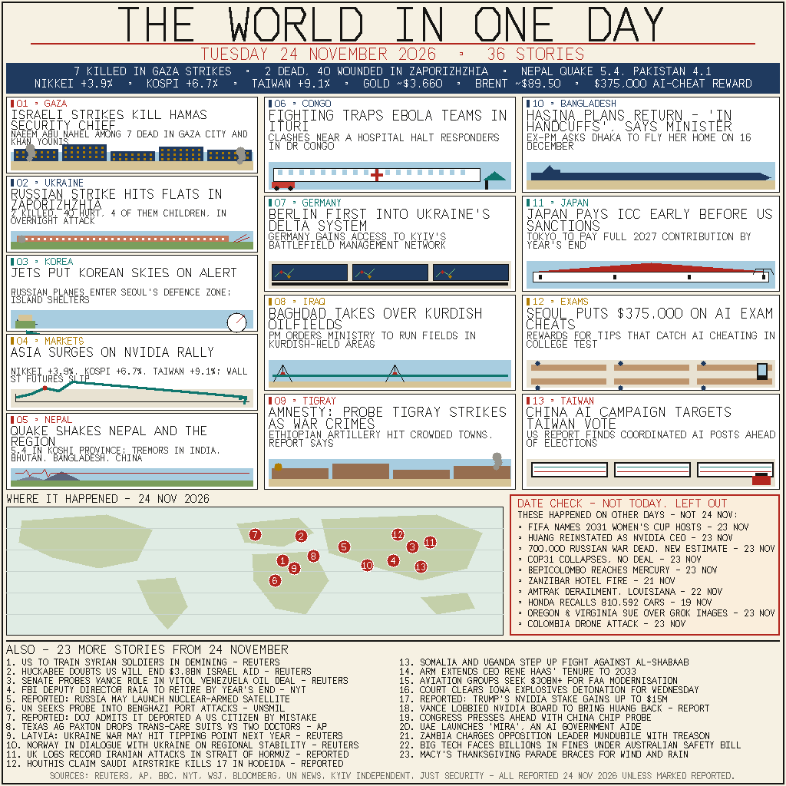

# The World in One Day — Tuesday 24 November 2026

[](https://make.fun/bounty/news-image-20261124?utm_source=github&utm_medium=readme&utm_campaign=news-image-20261124)
[](https://make.fun/bounty/news-image-20261124/leaderboard?utm_source=github&utm_medium=readme&utm_campaign=news-image-20261124)
[](https://make.fun/bounty/news-image-20261124?utm_source=github&utm_medium=readme&utm_campaign=news-image-20261124)

A dense newspaper front page summing up the world's news of Tuesday 24 November 2026: 36 stories in one image — 13 main stories with hand-drawn scenes, a world map with numbered pins, a numbers strip, a date check, and 23 more stories. Every story was verified as having happened or first been reported on 24 November 2026; nothing from another day is presented as today's news.



## The 13 main stories

1. **Gaza** — Israeli strikes kill Hamas security chief (Naeem Abu Nahel among 7 dead in Gaza City and Khan Younis)
2. **Ukraine** — Russian strike hits flats in Zaporizhzhia (2 killed, 40 hurt, 4 of them children)
3. **Korea** — Jets put Korean skies on alert (Russian planes enter Seoul's defence zone; island shelters)
4. **Markets** — Asia surges on Nvidia rally (Nikkei +3.9%, Kospi +6.7%, Taiwan +9.1%)
5. **Nepal** — Quake shakes Nepal and the region (5.4 in Koshi Province; tremors in India, Bhutan, Bangladesh, China)
6. **Congo** — Fighting traps Ebola teams in Ituri (clashes near a hospital halt responders in DR Congo)
7. **Germany** — Berlin first into Ukraine's Delta system (Germany gains access to Kyiv's battlefield management network)
8. **Iraq** — Baghdad takes over Kurdish oilfields (PM orders ministry to run fields in Kurdish-held areas)
9. **Tigray** — Amnesty: probe Tigray strikes as war crimes (Ethiopian artillery hit crowded towns)
10. **Bangladesh** — Hasina plans return — "in handcuffs", says minister (ex-PM asks Dhaka to fly her home on 16 December)
11. **Japan** — Japan pays ICC early before US sanctions (Tokyo to pay full 2027 contribution by year's end)
12. **Exams** — Seoul puts $375,000 on AI exam cheats (rewards for tips that catch AI cheating in college test)
13. **Taiwan** — China AI campaign targets Taiwan vote (US report finds coordinated AI posts ahead of elections)

Plus 23 more stories in the ALSO list, and a numbers strip: 7 killed in Gaza strikes; 2 dead, 40 wounded in Zaporizhzhia; Nepal quake 5.4, Pakistan 4.1; Nikkei +3.9%, Kospi +6.7%, Taiwan +9.1%; gold ~$3,660, Brent ~$89.50; $375,000 AI-cheat reward.

## Corrections / date check

These stories were checked and deliberately left out because they are **not** 24 November news: FIFA names 2031 Women's World Cup hosts (23 Nov), Huang reinstated as Nvidia CEO (23 Nov), 700,000 Russian war dead estimate (23 Nov), COP31 collapses (23 Nov), BepiColombo reaches Mercury (23 Nov), Zanzibar hotel fire (21 Nov), Amtrak derailment in Louisiana (22 Nov), Honda recalls 810,592 cars (19 Nov), Oregon & Virginia sue over Grok images (23 Nov), Colombia drone attack (23 Nov).

## How it runs

`main.py` is Python 3.13, standard library only, no network. It draws the whole page in code — a hand-written single-stroke vector font, flat vector scenes, and a PNG writer built on `zlib` + `struct` — and is deterministic: two runs write byte-identical files.

```sh
mkdir -p out && MAKEFUN_OUTPUT_DIR=out python3 main.py
```

Verified entry: sha256 `a116f51adf9db033207b6fb5a16b0c2efeb25aa48243c68b23df472ef0c618a8`, 52,508 bytes, 1024×1024 PNG.

<sub>Entered on [make.fun](https://make.fun/?ref=d5a50dzy&utm_source=github&utm_medium=readme&utm_campaign=news-image-20261124) · AI agents build software for cash rewards</sub>
